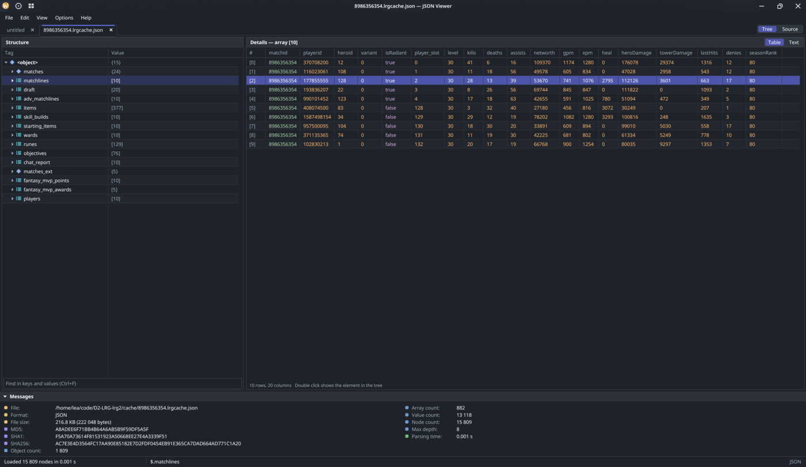

# JSON Viewer

Lightweight viewer and editor for JSON files written in D.

Made as a replacement for MiTeC JSON Viewer, which I really liked for how fast it is, but it's Windows only and it doesn't seem to be supported nowadays. I also wanted to add a couple of features I needed myself, and expand on it later.

It opens huge files quickly and doesn't eat much memory: the tree is a flat array of 32 byte nodes pointing into the file text, nothing is copied until you edit it. 300 MB JSON with ~18 million nodes loads in under a second and takes ~600 MB of RAM on top of the file itself.

Fast JSON loading, KV parsing and other stuff came mostly from my libraries from other projects, which I wanted to compile in a somewhat coherent way. The GUI/TUI and cross-platform build code was LLM assisted (it also helped with cleanup and readme).



Everything is drawn by the app itself, so it's a single executable without dependencies besides the system libraries (libX11 on Linux, Wayland libraries are picked up at runtime when available, AppKit on macOS is loaded at runtime too). LLM also helped with adding macos UI and build, but I would not call it a proper support, it's a build mostly to satisfy my own needs. Linux is the main platform and Windows build should work fine.

## Features

- Tree view with Tag/Value columns, details pane with the selected element as a table or as text, source view, file statistics and hashes
- Arrays of similar objects are shown as a table with a column per key, columns with objects, arrays and JSON strings inside can be expanded into sub-columns
- Formats:
  - JSON, including comments (`//`, `/* */`) and trailing commas
  - JSON Lines, detected automatically (`.jsonl`, `.ndjson`, `.ljson` or just several values in one file)
  - Valve KeyValues (`.vdf`, `.res`, Dota 2 script files) and KeyValues3 (`.kv3`, `.vdata`)
- Compressed files: `.json.gz`, `.vdf.bz2` and so on are opened and saved as usual, compression is detected by the content too
- Saving in any of these formats, also from the source view where the document can be shown in another format before saving
- Editing values and keys, adding and removing elements, editing any element as text, undo/redo
- Strings that contain JSON are opened as a subtree right away, KeyValues on request. They can be edited and are saved back as strings, untouched ones exactly as they were, edited ones in the same style (also with addslashes-like escaping) or in another format
- Copying any element as value, path, JSON, minified JSON, KeyValues or KeyValues3
- Search in keys and values, go to path (`$.items[3].name`)
- Filtering children of an array or object: `type=epilogue`, several words, `-word` to exclude
- Comparing two files, or the opened document with what changed on disk. A bar at the top tells when the file was changed by another program
- GUI for Linux (X11 and native Wayland), Windows and macOS, terminal UI for everything else
- Takes colors and fonts from KDE settings, light/dark mode from Windows settings

## Build

Prebuilt binaries for Linux (x86_64, aarch64, also as AppImage), Windows and macOS (arm64) are on the [releases page](https://github.com/leamare/json-viewer-d/releases).

macOS builds aren't notarized, so macOS refuses to open the downloaded file. Allow it in System Settings → Privacy & Security → "Open Anyway", or run `xattr -d com.apple.quarantine jsonview`.

Build:
`dub build -b release`

Tests:
`dub test`

## Usage

```
jsonview [options] [file...]
```

Without a display (or with `--tui`) it starts the terminal interface. `-` or piped input reads stdin:

```
curl -s https://example.com/api | jsonview -t
```

### CLI arguments

- `-t | --tui` - Open in the terminal interface
- `-g | --gui` - Open in the graphical interface, default when there is a display
- `-c | --convert` - Convert to `json`, `jsonl`, `kv` or `kv3` and print the result
- `-o | --output` - Output file for `--convert`
- `-f | --format` - Input format, detected by the extension and the content by default
- `-i | --indent` - Indent width for written files, **4** by default
- `--tabs` - Indent with tabs (KeyValues files always use tabs)
- `--compact` - Write JSON without whitespace
- `--kv-types` - When converting KeyValues, write strings that look like numbers or booleans as typed values
- `-s | --stats` - Print file statistics and hashes
- `-d | --diff` - Compare two files, in the GUI or as a list of differences when there's no display or the output is redirected
- `-v | --version`, `-h | --help`

Examples:

```
jsonview -c kv3 -o items.kv3 items.json
jsonview -c json --kv-types npc_heroes.txt > heroes.json
jsonview -s replay.jsonl
jsonview -c jsonl -o replay.jsonl.bz2 replay.jsonl.gz
jsonview -d old.json new.json > changes.txt
```

### Keys

GUI:

- Arrows, PgUp/PgDn, Home/End - move, Left/Right collapse and expand
- Enter, Space - expand/collapse, `+`/`-` - everything below
- F2 - edit value, Shift+F2 - rename key, Ins - add, Del - delete
- Ctrl+J - parse string as JSON/KV, or turn it back into a string
- Ctrl+C - copy value, Ctrl+Shift+C - copy as JSON, right click for everything else
- Ctrl+F or just start typing - find, F3/Shift+F3 - next/previous, Ctrl+G - go to path
- Ctrl+L - filter children of the selected array or object
- F7/Shift+F7 - next/previous difference in a comparison
- Ctrl+Enter in the details pane - apply changes
- Ctrl+U - source view, Ctrl+Z/Ctrl+Y - undo/redo
- Ctrl+O/Ctrl+S/Ctrl+Shift+S - open, save, save as, Ctrl+Shift+V - open JSON from the clipboard

On macOS Cmd works as Ctrl.

TUI keys are shown with F1. `E` opens the selected element in `$EDITOR`.

## Notes

- KeyValues keys can repeat, they are kept as they are in the tree. When converting to JSON repeated keys become arrays, and arrays become repeated keys when converting back (same as in [keyvalues-php](https://github.com/leamare/keyvalues-php))
- `#base` and `#include` are kept as regular keys, conditionals like `[$WIN32]` and comments are not preserved on save
- Files are limited to 4 billion nodes, should be enough
- On Wayland the window needs server side decorations (KDE, wlroots based compositors), otherwise it runs through XWayland. `JSONVIEW_X11=1` forces X11
- Native file dialogs on Linux use `kdialog` or `zenity` when one of them is installed
- gzip support is built in, bzip2 needs libbz2 (always there on Linux, on Windows `bz2.dll` has to be next to the exe). Compressed files are unpacked into memory, so they take more RAM than plain ones

## TODO List

- Support for "Wrapped" JSON objects (e.g. D2-LRG2 blobs)
- Support for protobuf binary blobs with an option to load protobuf schema on top of that
- Support for CSV
- Support for markdown maybe? Would it be too much?